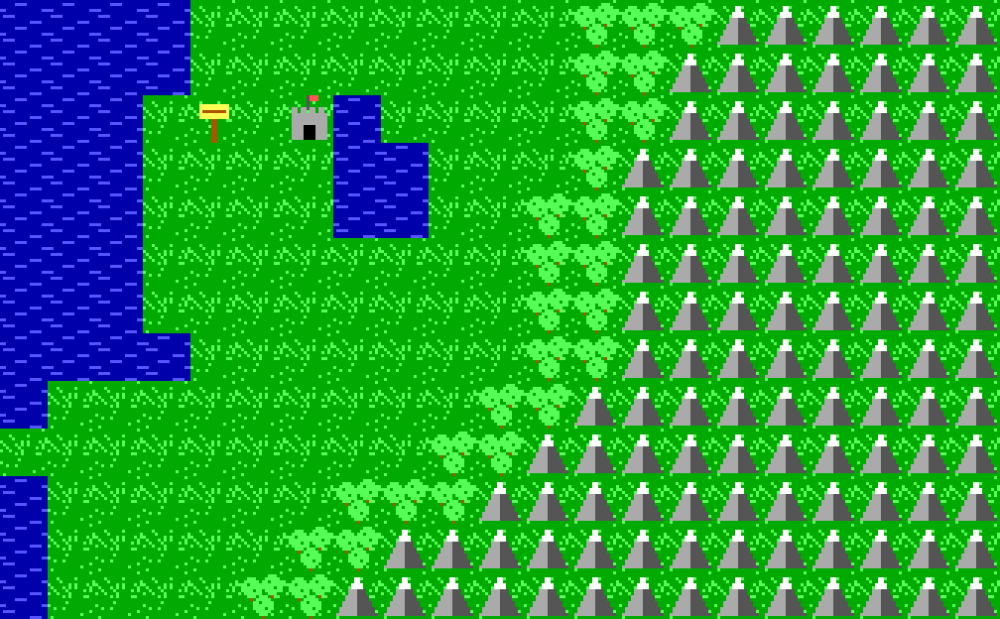

# ultima1-engine

An open-source re-implementation engine for Origin Systems' *Ultima I: The
First Age of Darkness* (the MS-DOS port of the 1986 remake, as sold on the
*Ultima 1-3* CD-ROM and by GOG.com). It is written independently in Rust
with SDL2, from a written specification. Linux first.

**Status: early.** Today it has:

* `u1-assets`: a library that parses the DOS data formats, verified
  against an original copy:
  * every tile file (EGA row-planar, CGA, Tandy and mono)
  * `MAP.BIN` (the overworld)
  * `TCD.BIN` (towns and castles)
  * `PLAYERn.U1` saves
  * the `CASTLE.16` / `CASTLE.4` title pictures and `NIF.BIN`
  * the location table, read at run time from your own `OUT.EXE`
  * the game's random number generator and its dungeon-level generator
  * the outdoor rules (movement, monsters, food, prices, shop stock),
    with their small tables read at run time from your own `OUT.EXE`
  * case-insensitive game-folder discovery
  * a small software renderer with the original animation timing
* `u1`: a playable overworld for your own game files. It has the
  original screen layout, movement and transports, food, wandering
  monsters, edge wrap and location names; entering places is still a
  stub.
* `u1view`: a scrollable overworld viewer, either for your own game files
  or for a fully synthetic `--demo` world.
* [`docs/SPEC.md`](docs/SPEC.md): the format and behaviour spec, with
  sources. Each item is marked as verified against original data,
  verified from the original executable, documented publicly, or unknown.



*The screenshot uses procedurally generated placeholder tiles and a
synthetic map. It contains no original game art.*

## Development policy: spec from reference, independent implementation

This is **not** a strict clean-room project. It works like this:

1. **Reference study stays outside the repository.** Maintainers may study
   a legally owned copy of the original game, both its data files and its
   executables (`ULTIMA.EXE`, `GEN.EXE`, `OUT.EXE`, `SPACE.EXE`,
   `MONDAIN.EXE`, `MOSLO.COM`). Study methods include running it in
   DOSBox, diffing save files, and disassembling or decompiling the
   executables, but only **for reference**. Disassembly listings,
   decompiled code, memory dumps and raw notes stay on the maintainer's
   machine and are never committed.
2. **Findings become a plain-language spec.** What was learned is restated
   in [`docs/SPEC.md`](docs/SPEC.md) in our own words: layouts, rules,
   and algorithms in prose or pseudocode, plus a few example values. Each
   item says how it was established ("verified against original data",
   "verified from original executable", public documentation, or
   unknown). Public community documentation is cited there as well.
3. **The engine is written fresh from the spec.** No original code is
   translated or pasted in. Do not copy decompiled code or large data
   tables from the executables into the repository. When the engine needs
   such a table (for example the location coordinates, monster stats,
   food rates or message strings), it reads it at run time from the
   user's own copy (`u1_assets::rules::ExeTables`, `::locations`).
4. **No original assets in the repository.** Never commit original game
   files (`.BIN`, `.EXE`, `.COM`, `.U1`, `CASTLE.*`, `NIF.BIN`), extracts
   from them, or screenshots that show original art. `.gitignore` blocks
   the usual extensions as a safety net. Do not use abandonware
   downloads.
5. **Third-party code is not copied.** Other projects' descriptions may be
   cited; their code may not be copied.
6. **Tests use synthetic data only.** Tests build their inputs from the
   spec and never read original files. One optional check runs against
   your own install when `U1_GAME_DIR` is set.

To run the engine with real data you need your own legally purchased copy.

## Building on Linux

Debian/Ubuntu:

```sh
sudo apt install build-essential pkg-config libsdl2-dev
# Rust toolchain: either the distro package...
sudo apt install cargo rustc          # Debian 13 ships Rust 1.85
# ...or rustup (https://rustup.rs):
curl --proto '=https' --tlsv1.2 -sSf https://sh.rustup.rs | sh

cargo build --release
cargo test
```

Fedora: `sudo dnf install SDL2-devel gcc pkgconf`.
Arch: `sudo pacman -S sdl2 base-devel`.

The minimum Rust version is 1.75. The project is developed and tested
with 1.85.1.

## Running

### Demo mode (no game files needed)

```sh
cargo run --release -p u1view -- --demo
cargo run --release -p u1view -- --demo --seed 42 --scale 4
```

### With your own copy (CD-ROM or GOG)

From the *Ultima 1-3* CD-ROM, point `--game-dir` at the `ULTIMA1` folder.
For GOG:

1. Install *Ultima 1+2+3* from GOG.
2. Find the Ultima I folder, for example `~/GOG Games/Ultima 1+2+3/Ultima1`
   or the folder where you unpacked the Windows installer with
   `innoextract`.
3. Look for `MAP.BIN` and `EGATILES.BIN` in that folder. If you only see a
   `game.gog` file, it is a disc image, and you need to extract it first:
   `7z x game.gog -ogame-files`. This step is unverified for U1; see
   SPEC §1.
4. Run the viewer:

```sh
cargo run --release -p u1view -- --game-dir "/path/to/Ultima1"
cargo run --release -p u1view -- --game-dir "/path/to/Ultima1" --mode cga
```

`u1view` looks for files case-insensitively, in the folder itself and in
`ULTIMA1/` or `U1/` subfolders. It picks the best available tile set:
EGA first, then Tandy, then CGA.

### Controls and options

| Key | Action |
|---|---|
| Arrow keys | Scroll 1 cell (hold Shift to scroll 8 cells) |
| Home | Recentre |
| Esc | Quit |

Options:

* `--scale N`, `--cols N`, `--rows N`
* `--start X,Y`
* `--seed N` (demo only)
* `--mode ega|t1k|cga`
* `--screenshot out.png`: renders one frame and exits.
* `--full-map out.png`: renders the whole 168x156 world to one image and
  exits.
* `--frame N`: the animation tick to render with `--screenshot`. One tick
  is about 0.165 s; water scrolls each tick, castles change every 3 ticks
  and towns every 4.
* `--locations` (needs `--game-dir`): prints the 84-entry location table
  read from your `OUT.EXE` and checks it against `MAP.BIN`.
* `--dungeon X,Y,LEVEL,SEED` (needs `--game-dir`): prints an ASCII map of
  the dungeon level the original generator would build for the entrance
  at X,Y. SEED is save word 0x32.

Screenshots also work headless:

```sh
SDL_VIDEODRIVER=dummy cargo run -p u1view -- --demo --start 100,104 --screenshot docs/demo.png
```

### Playing the game: `u1`

```sh
cargo run --release -p u1 -- --game-dir "/path/to/Ultima1" --player 2
```

**Just want to play?** Download the Linux AppImage from the releases and
see [PLAYING.md](PLAYING.md).

`u1` needs your own game folder. It reads `MAP.BIN`, `TCD.BIN`, the tile
sets, `OUT.EXE` (for its tables and texts) and a save. The game folder is
never written. Without `--game-dir` it looks for the folder in
`$U1_GAME_DIR`, beside the AppImage (or the program), in the current folder
and in `~/.local/share/ultima1-engine/game`, and lists the missing files if
none is complete (see PLAYING.md). With no start option it begins with the
title sequence and the character menu, as the original; `--pos` alone
starts a fresh character at the given place (default start (49,40)). It covers the overworld, towns and castles
(shops, pub, kings, jail and princess) and the ten-level dungeons with
their first-person view. Space and the time machine stop after their
entry message.

The keys are the original's:

| Key | Action |
|---|---|
| Arrow keys (the keypad's arrows too, NumLock on or off) | Move north/south/west/east (in a dungeon: forward, turn around, turn left, turn right) |
| 8 / 2 / 4 / 6 (number row) | Attack north/south/west/east without asking for a direction |
| Space | Pass |
| A | Attack (then a direction) |
| B / X | Board / exit a vehicle |
| C | Cast the ready spell |
| D | Drop (coin into a pond, in towns) |
| E | Enter a town, castle, dungeon or landmark |
| F | Fire (vehicles with cannons) |
| G | Get (castle storeroom, with the king's leave) |
| I / Z | Inform (in a dungeon: search for secret doors) / Ztats |
| K | Klimb a dungeon ladder (face north or south) |
| N | Noise on/off |
| O | Open a coffin (dungeon) |
| Q | Quit and save (outdoors only) |
| R | Ready a weapon, armour or spell |
| S | Steal (behind a shop counter) |
| T | Transact (shops, pub, king) |
| U | Unlock (castle jail doors, dungeon chests) |

If no key is pressed for 1,500 polls (about 3¼ minutes), the turn
passes by itself, as in the original. Options:

* `--player N` or `--save FILE` to load a save; `--pos X,Y` to override
  the position.
* `--save-to FILE`: where `Q` writes the 820-byte record. The default is
  `~/.local/share/ultima1-engine/saves/PLAYER1.U1` (`PLAYERn.U1` with
  `--player N`; FILE itself with `--save FILE`, or the roster file of
  the same name when FILE is in the game folder; `$XDG_DATA_HOME`), the
  folder that also holds the character menu's roster; the first time, the
  game's own `PLAYERn.U1` are copied there. Screenshots default to
  `./PLAYER1.U1`. It must not be inside the game folder.
* `--mode ega|t1k|cga`, `--scale N` (1–6, default 3).
* Like the original, the random generator is seeded from the save's seed
  word plus the time of day, and dungeon items are reseeded from the clock
  on each level. For reproducible runs (tests, screenshots) the hidden
  option `--seed N` fixes both the generator seed and the clock value.
* `--screenshot out.png` renders one 640×400 frame and exits.
  `--keys TEXT` types those keys first. Use `{up}` `{down}` `{left}`
  `{right}` `{enter}` `{esc}` `{bs}` `{space}` for special keys and `~`
  to end a timed wait. `--counter N` sets the animation counter.
* `--video enhanced [--pack DIR]`: the optional enhanced video mode
  (below). `--video original` is the default.
* `--sound original|enhanced|mute`: the original PC-speaker beeps (the
  default), the optional enhanced sounds (below), or nothing. `--mute` is
  the same as `--sound mute`.

```sh
SDL_VIDEODRIVER=dummy cargo run -p u1 -- --game-dir "/path/to/Ultima1" \
    --player 2 --seed 2 --keys "{up}{up}e" --screenshot /tmp/u1.png
```

### Enhanced video mode (optional)

The faithful 320×200 picture stays the default. `--video enhanced` draws
the same game at a higher internal resolution and paints the art of an
*asset pack* over each original tile it recognises:

```sh
cargo run --release -p u1 -- --game-dir "/path/to/Ultima1" --video enhanced
cargo run --release -p u1 -- --game-dir "/path/to/Ultima1" --video enhanced --pack my-pack/
```

* The default pack is `assets/enhanced/` (looked up in the current
  directory, then in the source tree). Anything it has no picture for is
  the original art scaled up nearest-neighbour.
* A pack is a directory with `manifest.toml` and PNG files. The manifest
  declares `tile_size` (pixels per original 16-pixel tile: 32 gives a
  640×400 internal screen, 64 gives 1280×800), and maps tile ids
  (`world.N`, `town.N`, `mond.N`, `screen.nif`, `dungeon.PART`,
  `dmon.N`) to a `file` or a list of
  animation `frames`, with optional `scroll` (water) and `fps`, or to
  `variants` (alternatives chosen per map cell by a fixed hash, so large
  grass fields do not repeat). An
  optional `[palette]` table holds free-form notes per video mode. See
  SPEC §20 and the docs at the top of `crates/u1-assets/src/enhanced.rs`.
* In dungeons the first-person view keeps the original geometry but is
  redrawn with the pack's wall, door, floor and ceiling textures (shaded
  by depth) and its object and monster sprites, if the pack has
  `dungeon.wall`. Secret doors look like walls, as in the original.
* Any id the pack does not list, and any tile the game has drawn over
  (text, cursor, effects), falls back to the original picture. Game
  logic, screen layout and the viewport are unchanged.
* The window is always a whole multiple of the internal resolution.
  `--screenshot` writes the internal resolution.

Pack art in this repository is original work, not derived from Origin's
tiles, and is licensed CC-BY-SA 4.0 (see `assets/enhanced/LICENSE`); the
engine code remains GPL-3.0-or-later.

The current pack (batch 1) covers the overworld: water (four frames),
grass (four variants), forest, mountains (three variants), the castle
(two pennant frames), the town (two smoke frames), the signpost, the
dungeon entrance and the player on foot, as 32×32 tiles in a
16-bit-console style with one shared 64-colour palette. Grass and
mountain variants share an identical edge band, so any mix of them
tiles seamlessly; the engine picks one per map cell. The pictures were
made with an image generator from text descriptions only (no original
tiles as input), then cut to the pixel grid, made seamless, given a
shared palette and hand-finished (pennants, smoke, tufts, the
hand-placed town cottages) with Python/Pillow.

The overworld monsters (all 15 kinds, two frames each like the
original) were added the same way: generated from text descriptions
only, cut out at 30 pixels on a 32×32 transparent tile and drawn over
the pack's terrain. The hidden archer and the evil trent still look
like bushes. The vehicles on the map (horse, cart, raft, frigate with
its two frames, aircar, shuttle and time machine) were made the same
way.

Batch 2 covers towns and castles: the castle wall, the
cobbled floor, water and its six shore shapes, bush, tree, the six
counter pieces, the grey brick wall and the people (guard, player,
jester, king, merchant, princess, wench) as 16×16 pictures; the letters
of shop signs stay original. It also covers the dungeon view: wall,
door, floor and ceiling textures, ladders, ceiling and floor holes,
chest, coffin, an animated force field and sprites for every monster but
the invisible seeker (the mimic uses the chest). Secret doors use the
wall on purpose. Town pictures were drawn procedurally or by hand; the
dungeon textures and monsters were made like batch 1 (generated from
text only, cut out, outlined and given their own 64-colour palette).

Batch 3 covers space flight: a riveted gunmetal frame for
the top-down view and a cockpit frame for the front view, a starfield
and a nebula behind them, the earth-like planet, the sun, the space
station, the three player ships, the enemy fighter and the crosshair.
The sector scan, shots, exhaust and explosions stay original.
It also covers Mondain's castle and the endgame: the stone floor and red
walls, the time machine, Mondain (two frames), his corpse, his gem and
its four glow frames, the demon he becomes (three frames), the six
frames of his fire spell, and a dim sunrise backdrop behind the closing
text. The text boxes and the victory box stay original.

Batch 4 (for review) covers the start-up screens: a new castle picture
for the title with its own "Ultima I" lettering and two crimson
pennants that wave exactly when the original's flags do (on EGA; the
CGA and Tandy castles stay original), a dim starry night behind the text title, a
dusk mountain panorama behind the Origin logo, "Presents", the two
story pages and the credits, and a dark leather page behind the
character menu and the "please wait" box. The Origin logo, every line
of original text (including the trademark and conversion credits) and
the menu borders stay original. Everything else falls back to the
original art.

### Enhanced sound mode (optional)

The original PC-speaker effects stay the default. `--sound enhanced`
plays the pack's sounds instead, one per game event:

```sh
cargo run --release -p u1 -- --game-dir "/path/to/Ultima1" --sound enhanced
cargo run --release -p u1 -- --sound-demo /tmp/demo.wav   # every sound after its original beep
```

* Sounds are `sounds/<event>.wav` in the pack folder (PCM WAV, any rate;
  mixed to mono 44.1 kHz by the engine through SDL audio, so they can
  overlap). Events are finer than the original's ten effects: a hit, a
  kill and taking damage share effect 2 in the original but have their
  own sounds here. The list is in `assets/enhanced/sounds/CREDITS`.
* An event with no file plays the original effect. A few events that are
  silent in the original (a miss, a dodged blow, launching, docking, the
  hyperspace jump) only sound in this mode, kept quiet and short.
* Levels match the beeps: each sound is about as loud as the effect it
  replaces; footsteps and the star field are soft; townspeople's steps
  are heard only within 4 squares of you (the original beeps for every
  one, and still does in the default mode).
* The game's timing is unchanged: the engine still waits as long as the
  original effect would have lasted; a longer enhanced sound plays on.
  The in-game Noise command (N) still turns all sound off and on.
* Music (F1, off by default) is separate from the effects mode: it plays with Original beeps or Enhanced sound; Mute silences it too.

Every sound in `assets/enhanced/sounds/` was synthesized for this project
by a script (oscillators and noise; no recordings or samples, and no
original game audio) and is licensed CC-BY-SA 4.0 like the art.

### Options menu (F1)

F1 pauses the game and opens a small options window, drawn like the
original's own shop and king windows:

* **Video**: Enhanced, EGA, CGA or Tandy (only the displays your game
  files include are offered; Enhanced is the pack's art over EGA).
* **Sound**: Original beeps, Enhanced or Mute.
* **Optional features** (all off by default; with them off the game
  plays exactly as before and every save stays an original player file):
  Fullscreen, Scaling (whole pixels or fill the window), CRT filter, Save
  slots, Message log, Turbo, Msg delay (original, 50%, 25%, none), Space
  speed and CPU timing. See "Optional features" below.

Up/Down chooses a line, Left/Right changes it, and F1, Enter or Esc
returns to the game. Changes apply at once without restarting: a new
display's pictures appear at the next command prompt, in space and
Mondain's lair too; on the title and character screens the program
starts again in the new display when the menu closes (a character being
made is dropped). With the enhanced art on, tiles the box only partly
covers keep their art around it. F1 is not one of the original's
keys; Esc is not used to open the menu because the character program
uses it.

The choice is saved to `~/.config/ultima1-engine/config.toml`
(`$XDG_CONFIG_HOME/ultima1-engine/config.toml` if that is set):

```toml
video = "enhanced"   # enhanced | ega | cga | tandy
sound = "original"   # original | enhanced | mute
```

Comments, other keys and tables in the file are kept when the menu saves.

`--video`, `--mode` (or `C`) and `--sound`/`--mute` override the file for
one run. Screenshots (`--screenshot`) ignore it; `--options` draws the menu
over a screenshot.

### Optional features (F1, all off by default except save slots and enhanced-video vehicle turning)

| Setting | Keys | What it does |
|---|---|---|
| Fullscreen | Alt+Enter | Fullscreen at the desktop's size. |
| Scaling | | Whole pixels (largest whole multiple, letterboxed) or fill the window. |
| CRT filter | | Scanlines and a slight glow, drawn after the frame. |
| Save slots | F2, F5, F9 | **On by default.** F2 opens five slots plus the quicksave (Up/Down or 1-5/Q, S save, L or Enter load, Esc back); F5 quicksaves and F9 quickloads. Slot 1 is the character's own file, the one Quit writes; the others sit beside it (`PLAYER2-slot2.U1`, `PLAYER2-quick.U1`) and every one is an original 820-byte record. Saving works outdoors only, as Quit does; loading restarts the game from the record. |
| Message log | PgUp, PgDn, Home, End | PgUp shows the last 500 lines of the message window, 12 at a time; PgDn at the newest page, Esc or Enter closes it. The message window itself is unchanged. |
| Turbo | F4 | Every wait 4x shorter. F4 works whether or not the menu turned it on. |
| Msg delay | | The pauses after messages: original, 50%, 25% or none. |
| Space speed | | Space flight's waits halved. |
| CPU timing | | "Steady": the PC-speaker effects no longer hold the game for their length (the original's CPU was busy playing them); the engine's other timing is already fixed rather than CPU-dependent. |

A short note at the top of the map reports saves, loads and F4. A slot
key pressed where the original would not take a command (a question, a
shop, space flight) is dropped with "Not now". Loading works anywhere a
command is taken; saving only outdoors. In `config.toml`:

```toml
fullscreen = true      # also Alt+Enter
scaling = "fill"       # whole | fill
crt = true
save_slots = true
message_log = true
turbo = true           # also F4
message_delay = 25     # 100 | 50 | 25 | 0
fast_space = true
steady_timing = true
```

Only settings that differ from the default are written. `--fullscreen` and
`--crt` turn those on for one run; `--smoothing off|linear|pixel-art` picks the
scaler for one run. Screenshots take `--crt`, `--slots`, `--log` and
`--smoothing`, and their `--keys` may hold `{save1}`..`{save5}`, `{saveq}`,
`{load1}`..

### More optional features (F1, all off by default; SPEC §23)

| Setting | Keys | What it does |
|---|---|---|
| Dungeon map | Tab (in a dungeon) | An automap of the squares you have seen on this level (one map per level; unfound secret doors look like walls, traps never show). |
| World map | Tab (elsewhere) | The overworld you have seen, the places you have entered and where you are. Opens zoomed in round you (4x); Z shows the whole world and back. |
| Character | Z | Z (Ztats) shows one combined, paged screen: stats, coin, gear, spells, transport, gems, enemy vessels, and each quest given: who gave it, what it is ("King of the Black Dragon: Slay a Lich"), and whether it is done ("Done! Return to the king."). Off: Z is the original Ztats. |
| Help screen | F3 | The commands and the engine's keys. |
| Hints | | A one-line hint above a command's prompt ("(B buy, S sell)"). |
| Confirm | | Ask "Sure? (Y/N)" before selling or dropping anything worth 10/50/100/250/500 or more. |
| Arrow repeat | | Our own repeat for a held arrow: Repeat delay (250-800 ms, default 250) and Repeat rate (default "Game pace", one step each pass of the main loop as the original moves; or 4-16 a second, never faster than the game pace). Repeats come only at the command prompt, so they never answer a question. "System" is the old behaviour. |
| Gamepad | | SDL game controllers: d-pad or left stick move; buttons as below. |
| Music | | Original chiptune music per area (title, overworld, town, castle, dungeon, space, Mondain's lair; victory and death stings), crossfaded on area changes and paused in the F1 menu. Music volume (10-100%, default 50%) is separate from the effects. Independent of the effects mode: it plays with Original beeps or Enhanced sound, following only its own switch and volume; Mute silences everything, music included. See CREDITS. |
| Smoothing | | How the picture is enlarged: Off (square pixels, as the original), Linear (bilinear filtering) or Pixel art (our own Scale2x/EPX edge-rounding scaler to at least 1280 wide, then a short linear stretch). Works in both EGA and enhanced video, and with whole-pixel scaling (the fit is still whole multiples of the original size). With CRT on, the pixel-art scaler runs first and the scanlines are drawn on its output; any smoothing also filters the CRT texture. Note: Pixel art also rounds the square corners of the screen frames and text-window borders (an effect of the edge-rounding scaler); use Linear or Off for sharp corners. |
| Keys | Enter | The rebind screen: give any command or screen one extra key. |

The maps are kept in `PLAYER2.U1.map` beside the player file, only with a
map on: written by Quit or a save slot, when the game ends any other way
(closing the window included), and on entering or leaving a town, castle
or dungeon. The record itself is never changed or written by any of these. The screens open only at the command prompt, take no turn, and
any key closes them.

**Extra keys.** The original's keys always work; a binding only adds a
key, and only keys the original ignores at its prompt can be bound (J L M
P W Y, 0 1 3 5 7 9, punctuation, Tab, F3 F6 F7 F8 F10-F12). In the rebind
screen: Up/Down choose, Enter then a key binds, Backspace clears, Esc
closes; changes are saved at once.

**Gamepad.** D-pad and left stick are the arrows. Default buttons: A
Space, B Esc, X Attack, Y Enter, Back map, Start options (F1), Guide help,
LB Klimb, RB Fire, left stick press Ztats, right stick press Ztats.
The mapping is tested with synthetic SDL controller events; testing with
a real controller is still to do.

```toml
automap = true
minimap = true
character_screen = true
help_screen = true
hints = true
confirm_value = 100    # 0 | 10 | 50 | 100 | 250 | 500
arrow_repeat = true
repeat_delay = 250     # ms: 250 | 400 | 600 | 800
repeat_rate = 0        # 0 = the game's pace (default) | 4 | 8 | 12 | 16 a second
gamepad = true
food_use = "original"  # original (default) | half | off: how fast food goes
                       # outdoors; buying and eating work in every mode. Half
                       # keeps its half unit in the engine, not the save.
footsteps = true       # overworld footsteps (enhanced sound only; default on)
music = true           # area music (default off)
music_volume = 50      # 10..100, separate from the effects
smoothing = "off"      # off (default) | linear | pixel-art
key_attack = "j"       # an extra key; "none" clears a default
key_map = "m"
pad_x = "r"            # a letter/digit, space, enter, esc, up/down/left/right,
                       # options, map, help, character or none
```

Screenshots take `--features automap,minimap,character,help,hints,repeat,gamepad,all,confirm=N`
(`--keys` may hold `{map}`, `{help}`, `{char}`), `--rebind` for the rebind
screen and `--menu-row N` with `--options`.

Tests that use your own files are skipped unless you point them at your
install:

```sh
U1_GAME_DIR="/path/to/Ultima1" cargo test --workspace
```

### Developer helpers

`u1 --music-demo out.wav` writes about 20 s of each music track (no game files needed).


```sh
# ASCII overview of a map (demo or real file)
cargo run -p u1-assets --example ascii_map -- --demo 1
cargo run -p u1-assets --example ascii_map -- /path/to/MAP.BIN
# Write a synthetic game dir (placeholder art) to test --game-dir
cargo run -p u1-assets --example write_synthetic_gamedir -- /tmp/synthgame
```

## Layout

```
crates/u1-assets   asset parsing and game-rules library (no dependencies)
crates/u1          SDL2 playable overworld
crates/u1view      SDL2 overworld viewer
docs/SPEC.md       data-format specification with sources
docs/ROADMAP.md    optional quality-of-life features (planned)
assets/enhanced    default asset pack for --video enhanced and --sound enhanced
docs/demo.png      demo screenshot (synthetic art)
packaging/         AppImage build script, .desktop file and icon (our own, CC-BY-SA 4.0)
.github/workflows  CI (ci.yml) and the AppImage release (release.yml)
PLAYING.md         how to play from the AppImage
```

## Continuous integration and releases

`.github/workflows/ci.yml` checks formatting (`cargo fmt --check`), builds,
runs the tests and runs `cargo clippy -- -D warnings` (lints allowed for
the workspace are listed with their reasons in `Cargo.toml`). No CI job has
game files, so the tests that need them skip themselves. To save Actions
minutes on the private repository, Linux runs on every push and pull
request, Windows (SDL2 built from source via the `u1/bundled` feature) on
pull requests and pushes to `main`, and macOS (ten times the minutes) only
when started by hand (`gh workflow run ci.yml`, or "Run workflow" in the
Actions tab, which also runs Windows).

`.github/workflows/release.yml` builds the AppImage
(`packaging/build-appimage.sh`, linuxdeploy on Ubuntu 22.04) on a `v*` tag
and attaches it to a GitHub release (a pre-release for tags such as
`v0.1.0-alpha.1`); started by hand it only keeps the AppImage as a run
artifact.

## Roadmap

1. Finish the remaining open items in SPEC §11.
2. Space and the Mondain battle.
3. Optional quality-of-life features, kept apart from the faithful mode
   (see [docs/ROADMAP.md](docs/ROADMAP.md)).
4. Enhanced video mode art: the title screens.

## License

GPL-3.0-or-later. See [LICENSE](LICENSE).
*Ultima* is a trademark of Electronic Arts. This project is not affiliated
with or endorsed by Electronic Arts or GOG. It ships no game content.
